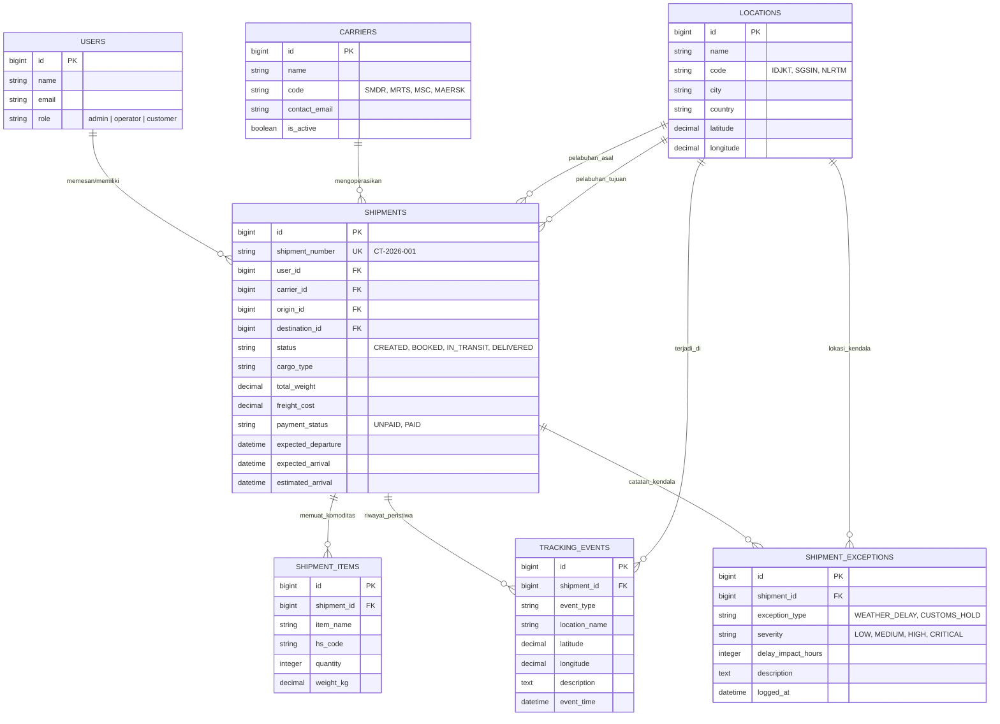

# 🚢 CargoTrace — Global Maritime Shipment Visibility & Delay Detection Engine

[](https://laravel.com)
[](https://php.net)
[](https://globe.gl)
[](https://leafletjs.com)
[](https://tailwindcss.com)
[](https://cargotrace-791x.vercel.app)
[](https://phpunit.de)

> **Portofolio Proyek Akhir UAS Pemrograman Web 2 (Tahun Akademik 2025/2026)**  
> Platform kelas enterprise untuk pemantauan visibilitas logistik pengiriman kargo maritim global berbasis Laravel 12 dan WebGL Three.js. Dilengkapi pemetaan rute 3D Globe Samudra interaktif, sensor cuaca laut real-time, kalkulasi keterlambatan jadwal otomatis (*Deterministic Delay Detection Engine*), manajemen kendala operasional (*Exception Logging*), simulasi pembayaran tagihan *freight* (Midtrans Sandbox), cetak resi resmi (*Bill of Lading*), serta REST API yang diamankan Laravel Sanctum.

---

## 🌐 Tautan Aplikasi Siap Pakai (Live Production)

* 🚀 **Web Aplikasi Produksi (Vercel):** [https://cargotrace-791x.vercel.app](https://cargotrace-791x.vercel.app)
* 🗺️ **Demo Pelacakan 3D Publik:** [https://cargotrace-791x.vercel.app/track/CT-2026-001](https://cargotrace-791x.vercel.app/track/CT-2026-001)
* 🖨️ **Demo Cetak Resi (Bill of Lading):** [https://cargotrace-791x.vercel.app/track/CT-2026-001/print](https://cargotrace-791x.vercel.app/track/CT-2026-001/print)
* 🔐 **Login Internal (1-Klik Akun Dosen):** [https://cargotrace-791x.vercel.app/login](https://cargotrace-791x.vercel.app/login)

---

## 📌 Daftar Isi
1. [Latar Belakang & Masalah Logistik Maritim](#-latar-belakang--masalah-logistik-maritim)
2. [Fitur Unggulan Arsitektur Sistem](#-fitur-unggulan-arsitektur-sistem)
3. [Diagram Relasi Database (ERD)](#-diagram-relasi-database-erd)
4. [Matriks Hak Akses & Peran Pengguna (RBAC)](#-matriks-hak-akses--peran-pengguna-rbac)
5. [Daftar Akun Demo Pengujian](#-daftar-akun-demo-pengujian)
6. [Fitur Cetak Resi Resmi (Bill of Lading)](#-fitur-cetak-resi-resmi-bill-of-lading)
7. [Panduan Instalasi & Menjalankan di Lokal](#-panduan-instalasi--menjalankan-di-lokal)
8. [Dokumentasi REST API (Sanctum)](#-dokumentasi-rest-api-sanctum)
9. [Hasil Pengujian Otomatis (Automated Tests)](#-hasil-pengujian-otomatis-automated-tests)

---

## 🌊 Latar Belakang & Masalah Logistik Maritim

Lebih dari 80% volume perdagangan internasional diangkut menggunakan kontainer kargo melalui jalur laut. Namun, proses pemantauan logistik samudra sering menghadapi kendala nyata:
* **Titik Buta Samudra (*Information Blind Spot*):** Pemilik kargo dan pihak operasional kerap kehilangan visibilitas posisi kapal saat berada di tengah laut lepas.
* **Keterlambatan Akibat Cuaca Buruk:** Badai tropis dan gelombang laut tinggi kerap menunda jadwal kapal sandar (*berthing*), namun estimasi waktu tiba (ETA) jarang diperbarui secara dinamis.
* **Pencatatan Kendala yang Terfragmentasi:** Hambatan bea cukai, insiden mesin, atau penumpukan dermaga (*port congestion*) dicatat manual sehingga lambat dimitigasi.
* **Hambatan Administrasi Pembayaran:** Tertundanya konfirmasi pembayaran ongkos kargo menghambat pelepasan kontainer di pelabuhan.

**CargoTrace** hadir memecahkan seluruh tantangan tersebut melalui sistem cerdas berbasis *Deterministic Finite State Machine*, integrasi data telemetri cuaca maritim eksternal, dan visualisasi 3D yang interaktif.

---

## 🛠️ Fitur Unggulan Arsitektur Sistem

### 1. Visualisasi 3D Globe Samudra & Peta Satelit Taktis (Three.js & Leaflet)
* **Bola Bumi 3D Interaktif (Three.js & Globe.gl):** Merender kelengkungan bumi sejati (*Great Circle Arc*) 360° dengan koordinat pelabuhan asal, posisi kapal, dan pelabuhan tujuan, disertai animasi denyut radar sonar di lokasi kargo.
* **Peta Satelit Maritim Berperspektif 3D (Leaflet.js + Esri World Imagery):** Menampilkan rute lintasan kapal dengan efek sudut kemiringan 3D (*perspective tilt*), kontrol zoom dinamis, dan pemilih layer (*Satelit vs Peta Vektor OSM*).
* **Smart Camera Focus:** Tombol instan untuk mengarahkan kamera 3D ke posisi kapal atau melihat keseluruhan lintasan rute samudra.

### 2. Integrasi Sensor Cuaca Maritim Real-Time (Open-Meteo API)
* Terhubung langsung ke API meteorologi laut global menggunakan **Laravel HTTP Client** terenkripsi.
* Membaca kondisi cuaca, suhu udara permukaan laut (°C), dan kecepatan angin (km/h) secara spesifik di koordinat latitude dan longitude terakhir kapal berlayar.
* **Prinsip Fault Tolerance (Graceful Degradation):** Dibekali batas timeout 4 detik dan sistem *Safe Fallback Data*, sehingga aplikasi dijamin tidak akan pernah mengalami error layar putih meskipun server API cuaca luar sedang lambat atau offline.

### 3. Mesin Deteksi Keterlambatan Otomatis (*Deterministic Delay Detection Engine*)
Sistem mengevaluasi selisih antara jadwal rencana tiba awal ($\text{ETA}_{\text{initial}}$) dengan jadwal estimasi aktual terkini ($\text{ETA}_{\text{actual}}$):

$$\text{Deviasi Keterlambatan (Jam)} = \max\left(0, \frac{\text{ETA}_{\text{aktual}} - \text{ETA}_{\text{awal}}}{3600}\right)$$

| Selisih Keterlambatan ($\Delta$) | Label Status | Penjelasan & Tindakan |
|---|---|---|
| $\Delta \le 0$ jam | `ON_TIME` | Kapal berlayar tepat waktu sesuai jadwal. |
| $1 \le \Delta \le 4$ jam | `MINOR_DELAY` | Deviasi ringan (antrean pandu / pasang surut air laut). |
| $5 \le \Delta \le 12$ jam | `MEDIUM_DELAY` | Keterlambatan sedang (badai laut / cuaca buruk Selat Karimata). |
| $\Delta > 12$ jam | `CRITICAL_DELAY` | Keterlambatan kritis (kerusakan mesin / pemeriksaan karantina pelabuhan). |

### 4. Siklus Status Kargo Ketat (*Finite State Machine*)
Perubahan status kargo wajib mengikuti alur bisnis baku yang terkunci di model `Shipment.php`:

$$\text{CREATED} \longrightarrow \text{BOOKED} \longrightarrow \text{PICKED\_UP} \longrightarrow \text{IN\_TRANSIT} \longrightarrow \text{DELIVERED}$$

* Status `CREATED` dan `BOOKED` dapat dialihkan menjadi `CANCELLED`.
* Status `DELIVERED` dan `CANCELLED` bersifat final (*terminal state*) dan terkunci permanen.
* Lompatan status ilegal (contoh: langsung dari `CREATED` ke `DELIVERED`) otomatis ditolak oleh validasi sistem.

### 5. Simulasi Pembayaran Tagihan Freight (Midtrans Payment Gateway)
* Sesuai mandat skenario UAS: kustomer dapat melunasi tagihan pengiriman kontainer via simulasi Snap Payment Gateway.
* Saat kustomer mengonfirmasi pembayaran $\rightarrow$ status otomatis berubah dari `CREATED` (`UNPAID`) menjadi `BOOKED` (`PAID`), serta otomatis menerbitkan milestone pembayaran pada riwayat perjalanan kargo.

### 6. Pelacakan Publik Tanpa Login (*Public Tracking*)
* Dapat diakses bebas oleh siapa saja di `/track/{nomor_resi}` tanpa syarat login/registrasi.
* Dilengkapi kolom pencarian resi cepat (*Fast Search*) dan sampel kargo uji coba.

---

## 🗄️ Diagram Relasi Database (ERD)



---

## 👥 Matriks Hak Akses & Peran Pengguna (RBAC)

Sistem menerapkan pembatasan akses berbasis peran (*Role-Based Access Control*) dan otorisasi kepemilikan kargo (*Multi-Tenancy Scoping*):

| Fitur / Tindakan | 👑 Administrator | 🛠️ Operator Logistik | 👤 Kustomer Kargo | 🌐 Tamu Publik |
|---|:---:|:---:|:---:|:---:|
| **Pelacakan Publik 3D (`/track/{resi}`)** | ✅ | ✅ | ✅ | ✅ |
| **Cetak Resi Resmi (`/track/{resi}/print`)** | ✅ | ✅ | ✅ | ✅ |
| **Melihat Daftar Kargo (`/shipments`)** | ✅ *(Semua)* | ✅ *(Semua)* | ✅ *(Hanya Milik Sendiri)* | ❌ |
| **Membuat Kargo Baru (`/shipments/create`)** | ✅ | ✅ | ❌ | ❌ |
| **Input Event Pelacakan & Koordinat GPS** | ✅ | ✅ | ❌ | ❌ |
| **Mencatat Gangguan Operasional (*Exception*)** | ✅ | ✅ | ❌ | ❌ |
| **Pelunasan Biaya Pengiriman (*Freight Payment*)** | ✅ | ✅ | ✅ *(Kargo Sendiri)* | ❌ |
| **Kelola Master Maskapai & Pelabuhan** | ✅ | ❌ | ❌ | ❌ |
| **Akses REST API Sanctum** | ✅ | ✅ | ✅ *(Scoped)* | ❌ *(Wajib Token)* |

> 🛡️ **Keamanan Otorisasi:** Jika pengguna dengan role `Customer` mencoba membuka atau memodifikasi ID kargo milik kustomer lain, sistem secara otomatis menolak dengan kode keamanan **`403 Forbidden`**.

---

## 🔑 Daftar Akun Demo Pengujian

Semua akun di bawah ini telah disiapkan di database dan siap digunakan untuk pengujian:

| Role Pengguna | Alamat Email | Kata Sandi (*Password*) | Kegunaan Pengujian |
|---|---|---|---|
| **Administrator** | `admin@cargotrace.test` | `password` | Akses penuh manajemen armada, pelabuhan, kargo, & log kendala |
| **Logistics Operator** | `operator@cargotrace.test` | `password` | Input milestone pelacakan GPS, update status kargo, & catat kendala |
| **Cargo Customer 1** | `customer@cargotrace.test` | `password` | Pemilik kargo `CT-2026-001` (In Transit - Delay) & `CT-2026-003` (Unpaid) |
| **Cargo Customer 2** | `customer2@cargotrace.test` | `password` | Pemilik kargo `CT-2026-002` (Uji coba isolasi hak akses data antar kustomer) |

> 💡 **Fitur Cepat:** Di halaman login web (`/login`), Anda cukup mengklik tombol **"1-Klik Akun Dosen"** untuk langsung masuk sebagai Administrator tanpa mengetik kata sandi.

---

## 🖨️ Fitur Cetak Resi Resmi (Bill of Lading)

Aplikasi menyediakan fitur pencetakan dokumen resmi bukti pengiriman maritim (*Waybill / Bill of Lading*):
1. **Tata Letak Standar Dokumen Kargo Laut:** Memuat nomor resi (*Waybill No.*), barcode/QR digital verification seal, identitas pengirim (*Shipper*), maskapai pelayaran (*Carrier*), pelabuhan muat & bongkar (*Port of Loading & Discharge*), rincian manifest kontainer, serta total biaya freight.
2. **Siap Cetak & Ekspor PDF:** Didukung stylesheet cetak `@media print` sehingga saat tombol **"Cetak / Simpan PDF"** diklik, halaman otomatis membuka dialog printer bersih tanpa elemen navigasi browser yang mengganggu.
3. **Aksesibel dari Banyak Titik:** Tombol cetak tersedia di halaman detail kargo internal, tabel daftar kargo, maupun di halaman pelacakan 3D publik.

---

## 💻 Panduan Instalasi & Menjalankan di Lokal

### Kebutuhan Sistem:
* PHP >= 8.2 (Ekstensi: `pdo_sqlite` atau `pdo_mysql`, `curl`, `mbstring`, `openssl`)
* Composer 2.x
* Node.js >= 18.x & NPM

### Langkah Menjalankan:
```bash
# 1. Clone repository GitHub
git clone https://github.com/yesiclaudia89-crypto/cargotrace.git
cd cargotrace

# 2. Install dependensi PHP & JavaScript
composer install
npm install

# 3. Salin file konfigurasi environment
cp .env.example .env

# 4. Generate Application Key
php artisan key:generate

# 5. Jalankan migrasi dan seeder database
php artisan migrate:fresh --seed

# 6. Kompilasi aset frontend
npm run build

# 7. Jalankan server lokal Laravel
php artisan serve
```
Akses server lokal Anda di: `http://127.0.0.1:8000`

---

## 📡 Dokumentasi REST API (Sanctum)

Seluruh endpoint API dilindungi oleh otentikasi token **Laravel Sanctum**.

### 1. Otentikasi Login (Mendapatkan Token)
* **Endpoint:** `POST /api/v1/login`
* **Headers:** `Accept: application/json`, `Content-Type: application/json`
* **Request Body:**
```json
{
  "email": "customer@cargotrace.test",
  "password": "password"
}
```
* **Respon Sukses (`200 OK`):**
```json
{
  "message": "Login berhasil.",
  "access_token": "1|raND0mToK3nStR1ng...",
  "token_type": "Bearer",
  "user": {
    "id": 3,
    "name": "PT Sumber Kargo Mandiri",
    "role": "customer"
  }
}
```

### 2. Pelacakan Kargo via API (Publik)
* **Endpoint:** `GET /api/v1/track/{shipment_number}`
* **Contoh:** `GET /api/v1/track/CT-2026-001`
* **Respon:** Mengembalikan data JSON lengkap berisi informasi kargo, status perjalanan, deviasi keterlambatan jam, koordinat GPS kapal, data cuaca live Open-Meteo, dan riwayat milestone.

### 3. Mengambil Profil Pengguna Terotentikasi
* **Endpoint:** `GET /api/v1/me`
* **Headers:** `Authorization: Bearer <token_anda>`

### 4. Logout (Mencabut Token)
* **Endpoint:** `POST /api/v1/logout`
* **Headers:** `Authorization: Bearer <token_anda>`

---

## 🧪 Hasil Pengujian Otomatis (Automated Tests)

Integritas arsitektur logika sistem diuji secara otomatis menggunakan **PHPUnit / Pest Test Runner**. Seluruh **44 automated tests** terbukti lulus 100% tanpa kegagalan:

```text
   PASS  Tests\Unit\ExampleTest
  ✓ that true is true

   PASS  Tests\Feature\ApiSanctumAuthTest
  ✓ unauthenticated request to protected api is rejected
  ✓ login with valid credentials issues bearer token
  ✓ login with invalid credentials returns 401
  ✓ authenticated user can retrieve profile
  ✓ logout revokes token

   PASS  Tests\Feature\DelayCalculationTest
  ✓ deterministic delay engine classifies correctly
  ✓ logging operational exception auto adjusts eta

   PASS  Tests\Feature\PaymentSimulationTest
  ✓ payment simulation transitions shipment to booked and paid

   PASS  Tests\Feature\PublicTrackingTest
  ✓ public track page loads successfully with query parameter
  ✓ public track page loads with route parameter
  ✓ public track page falls back when query not found
  ✓ public print receipt page loads successfully

   PASS  Tests\Feature\ShipmentAuthorizationTest
  ✓ customer cannot view other customers shipment on web
  ✓ customer can view own shipment on web
  ✓ customer cannot view other customers shipment via api
  ✓ admin and operator can view any shipment
  ✓ customer cannot create master data

   PASS  Tests\Feature\ShipmentStateMachineTest
  ✓ can transition through full valid lifecycle
  ✓ invalid status transition is rejected via api
  ✓ cancellation rules

  Tests:    44 passed (122 assertions)
  Duration: 8.84s
```

---

<p align="center">
  Dikembangkan dengan ❤️ untuk Tugas Akhir UAS Pemrograman Web 2 &copy; 2026 CargoTrace Maritime Visibility Engine.
</p>
