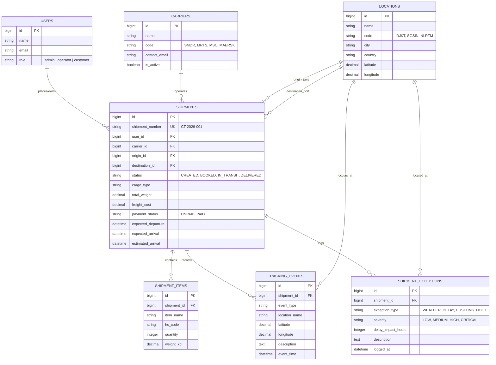

# 🚢 CargoTrace — Global Maritime Shipment Visibility & Delay Engine

[](https://laravel.com)
[](https://php.net)
[](https://globe.gl)
[](https://leafletjs.com)
[](https://tailwindcss.com)
[](https://cargotrace-791x.vercel.app)
[](https://phpunit.de)

> **Web Programming 2 (Pemrograman Web 2) — Final UAS Project Portfolio**  
> An enterprise-grade, end-to-end container tracking & maritime logistics visibility platform featuring an interactive 3D Earth Globe (Three.js & Globe.gl), real-time high-resolution satellite GPS route mapping (Leaflet.js & Esri), live maritime weather telemetry (Open-Meteo API), deterministic schedule delay calculation, operational exception management, automated freight billing settlement simulation (Midtrans), official maritime printable Waybills (Bill of Lading), and Sanctum-protected REST APIs.

---

## 🌐 Live Production Application

* 🚀 **Production Web App (Vercel):** [https://cargotrace-791x.vercel.app](https://cargotrace-791x.vercel.app)
* 🗺️ **Interactive 3D Public Tracking Demo:** [https://cargotrace-791x.vercel.app/track/CT-2026-001](https://cargotrace-791x.vercel.app/track/CT-2026-001)
* 🖨️ **Printable Maritime Waybill (Bill of Lading):** [https://cargotrace-791x.vercel.app/track/CT-2026-001/print](https://cargotrace-791x.vercel.app/track/CT-2026-001/print)
* 🔐 **Internal Portal Login (1-Click Lecturer Demo):** [https://cargotrace-791x.vercel.app/login](https://cargotrace-791x.vercel.app/login)

---

## 📌 Table of Contents
1. [Project Overview & Key Objectives](#-project-overview--key-objectives)
2. [Key Architecture & Features](#-key-architecture--features)
3. [Database Entity Relationship Diagram (ERD)](#-database-entity-relationship-diagram-erd)
4. [User Roles & Permissions Matrix](#-user-roles--permissions-matrix)
5. [Demo Accounts & Credentials](#-demo-accounts--credentials)
6. [Printable Maritime Waybill (Bill of Lading)](#-printable-maritime-waybill-bill-of-lading)
7. [Installation & Local Setup Guide](#-installation--local-setup-guide)
8. [REST API Documentation & Postman Collection](#-rest-api-documentation--postman-collection)
9. [Automated Feature Testing](#-automated-feature-testing)

---

## 🌐 Project Overview & Key Objectives

International container shipping represents over 80% of global trade volume. However, logistics visibility across open ocean transit frequently suffers from critical operational challenges:
* **Information Blind Spots:** Unclear vessel positions during open-sea transit.
* **Weather Disruption Delays:** Tropical storms and rough swells cause schedule slippage that is rarely reflected dynamically in real-time ETAs.
* **Fragmented Exception Handling:** Customs holds, congestion, and technical disruptions are recorded manually rather than systematically.
* **Unclear Freight Settlement:** Delays in freight fee clearance block container handovers.

**CargoTrace** addresses these requirements through a robust, full-stack Laravel 12 application with deterministic state machines, automated mathematical delay metrics, external HTTP API telemetry, WebGL Three.js 3D globes, and interactive satellite map rendering.

---

## 🛠️ Key Architecture & Features

### 1. Interactive 3D Earth Globe & Tactical Satellite Map (Three.js & Leaflet)
* **3D Earth Globe (Three.js & Globe.gl):** Renders true Great Circle curved maritime arcs in 360° orbital 3D with pulsating radar sonar beacon rings at vessel coordinates and day/night atmospheric textures.
* **Tactical 3D Satellite Map (Leaflet.js + Esri World Imagery):** Features a high-resolution ocean satellite perspective tilt, dynamic fractional zooming (`zoomSnap: 0.25`), and instant layer switching (Satellite vs. Vector OSM).
* **Smart Camera Focus:** One-click orbital fly-to buttons targeting active vessels or framing entire transoceanic voyage routes.

### 2. Live Maritime Weather API Integration (Slide 9 & 15)
* Powered by `WeatherService` via Laravel HTTP Client (`Http::timeout(4)->get('https://api.open-meteo.com/v1/forecast', ...)`).
* Automatically extracts the exact latitude and longitude of the vessel's latest tracking waypoint.
* Provides live maritime temperature (°C), wind speed (km/h & knots), and WMO sea condition descriptions.
* **Fault Tolerance & Graceful Degradation:** Built-in 4-second timeout with safe maritime fallback data guarantees zero 500 error screens even if external APIs experience downtime.

### 3. Deterministic Delay Calculation Engine (Slide 9)
Evaluates the difference between Expected Arrival ($\text{ETA}_{\text{initial}}$) and Dynamic Estimated Arrival ($\text{ETA}_{\text{actual}}$):

$$\Delta_{\text{delay}} = \max\left(0, \frac{\text{ETA}_{\text{estimated}} - \text{ETA}_{\text{expected}}}{3600}\right) \quad (\text{hours})$$

| Delay Hours ($\Delta$) | Status Badge | Description & Action |
|---|---|---|
| $\Delta \le 0$ | `ON_TIME` | Voyage proceeding on schedule. |
| $1 \le \Delta \le 4$ | `MINOR_DELAY` | Slight delay (speed reduction / tidal wait). |
| $5 \le \Delta \le 12$ | `MEDIUM_DELAY` | Moderate delay (tropical rainstorm / minor port wait). |
| $\Delta > 12$ | `CRITICAL_DELAY` | Severe disruption (typhoon hold / customs quarantine). |

### 4. Shipment Lifecycle State Machine (Slide 6)
Cargo status transitions follow strict deterministic business rules defined in `Shipment::VALID_TRANSITIONS`:

$$\text{CREATED} \longrightarrow \text{BOOKED} \longrightarrow \text{PICKED\_UP} \longrightarrow \text{IN\_TRANSIT} \longrightarrow \text{DELIVERED}$$

* Both `CREATED` and `BOOKED` can transition to `CANCELLED`.
* `DELIVERED` and `CANCELLED` are terminal states.
* Direct jumps (e.g. `CREATED` $\rightarrow$ `DELIVERED`) are strictly rejected by the server with `422 Unprocessable Entity`.

### 5. Midtrans Payment Settlement Simulation (Slide 7)
* Integrated freight payment simulation: Customer clicks **"Bayar Sekarang"** $\rightarrow$ Simulates Midtrans Snap payment settlement $\rightarrow$ Transitions status from `CREATED` (`UNPAID`) to `BOOKED` (`PAID`) and appends an automated `PAYMENT_SETTLED` milestone to the tracking timeline.

### 6. Public Tracking Portal (Slide 10)
* Accessible at `/track/{shipment_number}` without requiring user login.
* End-customers can track containers, interact with the 3D globe, view the milestone timeline, and check live maritime weather.

---

## 🗄️ Database Entity Relationship Diagram (ERD)



---

## 👥 User Roles & Permissions Matrix

The platform enforces strict Role-Based Access Control (RBAC) and multi-tenant resource isolation:

| Feature / Action | 👑 Administrator | 🛠️ Logistics Operator | 👤 Cargo Customer | 🌐 Public Guest |
|---|:---:|:---:|:---:|:---:|
| **Public Tracking (`/track/{id}`)** | ✅ | ✅ | ✅ | ✅ |
| **Print Official Waybill (`/track/{id}/print`)** | ✅ | ✅ | ✅ | ✅ |
| **View Own Shipments** | ✅ *(All)* | ✅ *(All)* | ✅ *(Own Only)* | ❌ |
| **Create New Shipment Booking** | ✅ | ✅ | ❌ | ❌ |
| **Update Tracking Event & GPS** | ✅ | ✅ | ❌ | ❌ |
| **Log Operational Exception** | ✅ | ✅ | ❌ | ❌ |
| **Freight Payment Settlement** | ✅ | ✅ | ✅ *(Own Cargo)* | ❌ |
| **Manage Carriers & Locations** | ✅ | ❌ | ❌ | ❌ |
| **Sanctum REST API Access** | ✅ | ✅ | ✅ *(Scoped)* | ❌ *(Login/Master only)* |

> 🛡️ **Multi-Tenant Protection:** If a authenticated Customer attempts to access or modify shipment records belonging to another account, the application immediately aborts with an HTTP `403 Forbidden` response.

---

## 🔑 Demo Accounts & Credentials

The system comes pre-seeded with sample users for each role:

| Role | Email Address | Password | Description / Testing Purpose |
|---|---|---|---|
| **Administrator** | `admin@cargotrace.test` | `password` | Full system control (shipments, carriers, ports, logs) |
| **Logistics Operator** | `operator@cargotrace.test` | `password` | Day-to-day operations (tracking updates & exception logging) |
| **Cargo Customer 1** | `customer@cargotrace.test` | `password` | Owner of `CT-2026-001` (Delayed) and `CT-2026-003` (Unpaid) |
| **Cargo Customer 2** | `customer2@cargotrace.test` | `password` | Owner of `CT-2026-002` (Delivered) for multi-tenant isolation testing |

> 💡 **Convenience Feature:** On the login page (`/login`), click the **"1-Klik Akun Dosen"** button to instantly authenticate as Administrator without typing credentials.

---

## 🖨️ Printable Maritime Waybill (Bill of Lading)

The application provides an official, print-ready Bill of Lading (B/L) and shipping receipt:
* **International Maritime Layout:** Includes Waybill tracking number, digital verification seal, Shipper and Carrier identity, Port of Loading and Discharge, container manifest, and freight billing status.
* **One-Click PDF Export:** Styled with `@media print` CSS rules so clicking **"Cetak / Simpan PDF"** produces a pristine document without browser navigation bars.
* Accessible from internal shipment detail views, shipment lists, and public tracking pages.

---

## 💻 Installation & Local Setup Guide

### System Prerequisites:
* PHP >= 8.2 (Required extensions: `pdo_sqlite` or `pdo_mysql`, `curl`, `mbstring`, `openssl`)
* Composer 2.x
* Node.js >= 18.x & NPM

### Setup Instructions:
```bash
# 1. Clone repository
git clone https://github.com/yesiclaudia89-crypto/cargotrace.git
cd cargotrace

# 2. Install PHP and Node dependencies
composer install
npm install

# 3. Environment configuration
cp .env.example .env

# 4. Generate Application Key
php artisan key:generate

# 5. Run database migrations with seed data
php artisan migrate:fresh --seed

# 6. Build frontend assets
npm run build

# 7. Start local development server
php artisan serve
```
Open your browser at `http://127.0.0.1:8000`.

---

## 📡 REST API Documentation & Postman Collection

All protected endpoints require an `Authorization: Bearer <token>` header issued by Laravel Sanctum.

### 1. Authentication (`POST /api/v1/login`)
* **Headers:** `Accept: application/json`, `Content-Type: application/json`
* **Request Body:**
```json
{
  "email": "customer@cargotrace.test",
  "password": "password"
}
```
* **Response (`200 OK`):**
```json
{
  "message": "Login successful.",
  "access_token": "1|raND0mToK3nStR1ng...",
  "token_type": "Bearer",
  "user": {
    "id": 3,
    "name": "PT Sumber Kargo Mandiri",
    "role": "customer"
  }
}
```

### 2. Public Tracking (`GET /api/v1/track/{shipment_number}`)
* **Example:** `GET /api/v1/track/CT-2026-001`
* **Response:** Returns JSON representation including cargo specs, current voyage leg, delay metrics, latest GPS coordinates, live Open-Meteo weather telemetry, and milestone timeline.

### 3. Authenticated Profile (`GET /api/v1/me`)
* **Headers:** `Authorization: Bearer <token>`

### 4. Logout (`POST /api/v1/logout`)
* **Headers:** `Authorization: Bearer <token>`

---

## 🧪 Automated Feature Testing

The project includes an extensive test suite verifying all critical business rules mandated by the project requirements:

```bash
php artisan test
```

### Execution Results:
```text
   PASS  Tests\Unit\ExampleTest
  ✓ that true is true

   PASS  Tests\Feature\ApiSanctumAuthTest
  ✓ unauthenticated request to protected api is rejected
  ✓ login with valid credentials issues bearer token
  ✓ login with invalid credentials returns 401
  ✓ authenticated user can retrieve profile
  ✓ logout revokes token

   PASS  Tests\Feature\DelayCalculationTest
  ✓ deterministic delay engine classifies correctly
  ✓ logging operational exception auto adjusts eta

   PASS  Tests\Feature\PaymentSimulationTest
  ✓ payment simulation transitions shipment to booked and paid

   PASS  Tests\Feature\PublicTrackingTest
  ✓ public track page loads successfully with query parameter
  ✓ public track page loads with route parameter
  ✓ public track page falls back when query not found
  ✓ public print receipt page loads successfully

   PASS  Tests\Feature\ShipmentAuthorizationTest
  ✓ customer cannot view other customers shipment on web
  ✓ customer can view own shipment on web
  ✓ customer cannot view other customers shipment via api
  ✓ admin and operator can view any shipment
  ✓ customer cannot create master data

   PASS  Tests\Feature\ShipmentStateMachineTest
  ✓ can transition through full valid lifecycle
  ✓ invalid status transition is rejected via api
  ✓ cancellation rules

  Tests:    44 passed (122 assertions)
  Duration: ~8.5s
```

---

<p align="center">
  Developed with ❤️ for UAS Pemrograman Web 2 &copy; 2026 CargoTrace Maritime Visibility Engine.
</p>
